# Deutsch Trainer

A personal, local-first German trainer built around **your own lessons**. You bring the material (words, example sentences, exercises) in a simple file; the app turns it into practice focused on **recognising words when you read them and when you hear them**, backed by spaced repetition and natural-sounding text-to-speech that runs on your own machine.

There are no accounts and no cloud services to depend on. Your lessons and progress stay in your browser.

| Home | Lesson |
| :--: | :--: |
| 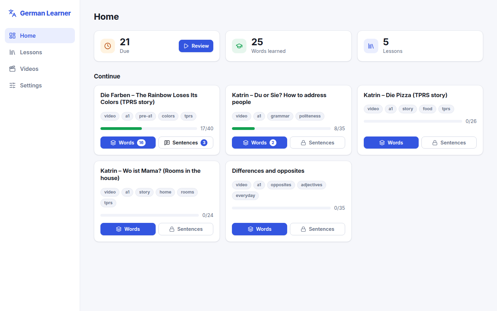 | 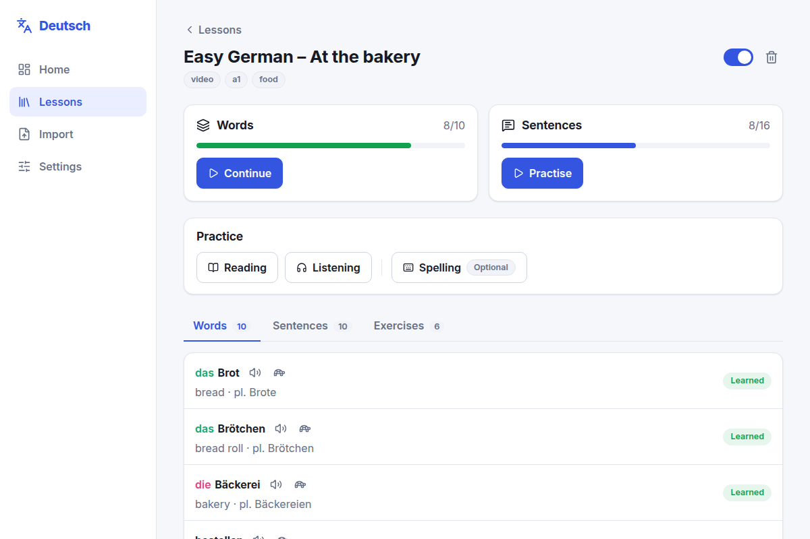 |

## Why it exists

Learning from comprehensible input (videos, podcasts) stalls when you do not know enough words to follow along. This app closes that gap:

- **Learn from what you actually watch.** Turn the vocabulary and sentences of any video or text into a lesson file and import it.
- **Words before sentences.** You are assumed to know almost no vocabulary, so every content word is learned first. Sentences and exercises unlock only after most of a lesson's words are learned.
- **Recognition first.** The main path is *reading* a word and recalling its meaning, and *hearing* a word and recalling its meaning. Typing (spelling) is a separate, optional practice.
- **Listening is central.** Every word and sentence can be played at normal or slow speed, on repeat, with audio generated locally.
- **Repetition that adapts.** Cards come back on a spaced-repetition schedule ([FSRS](https://github.com/open-spaced-repetition/ts-fsrs)), so things you struggle with return sooner.

## Screenshots

| Meeting a new word | Reading: recall the meaning |
| :--: | :--: |
| 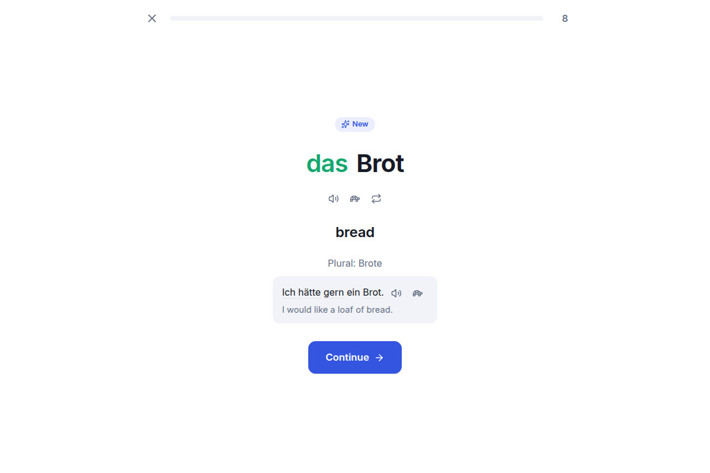 | 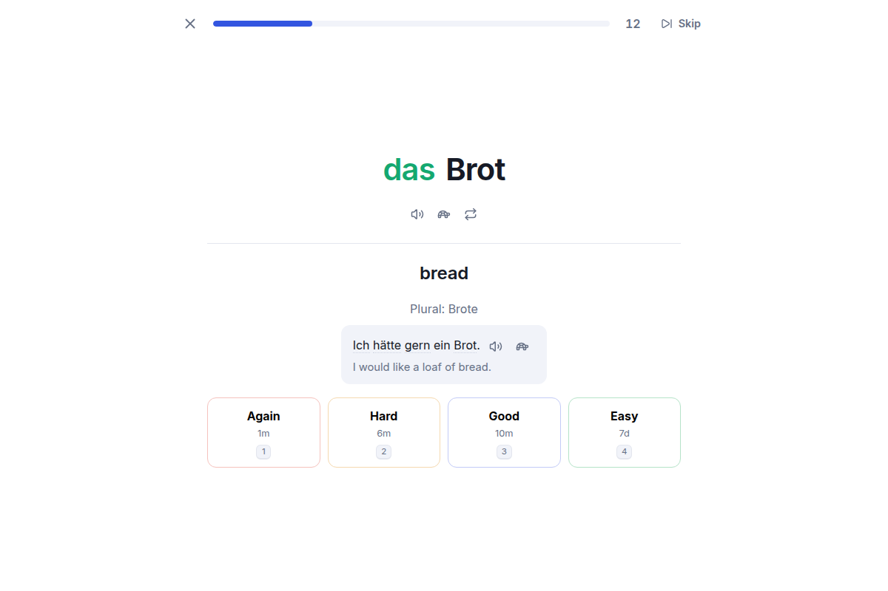 |

| Listening: hear it, recall the meaning | Listen and choose (exercise) |
| :--: | :--: |
| 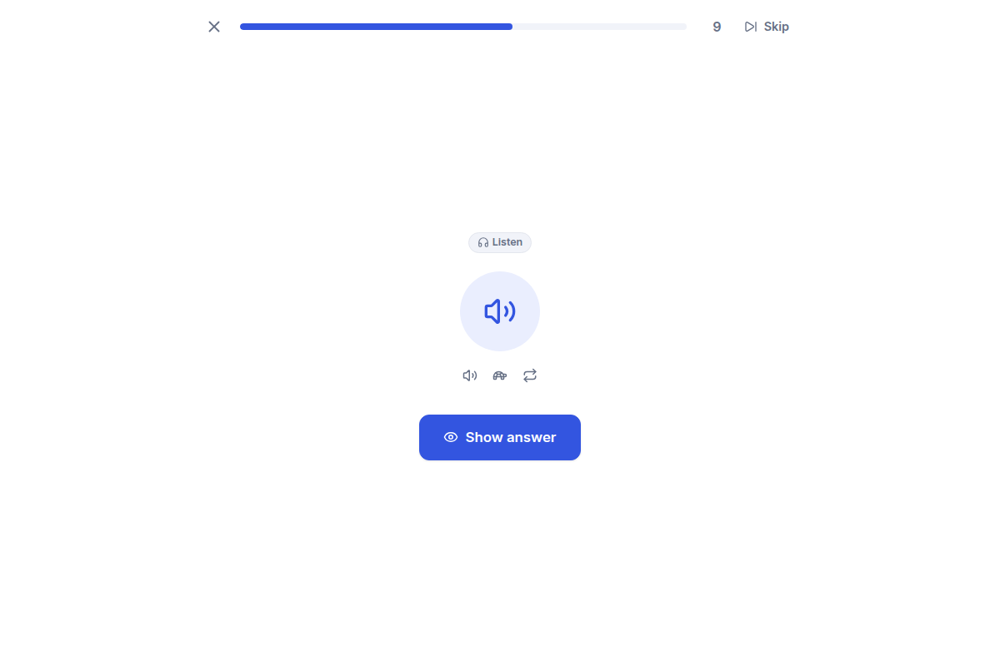 | 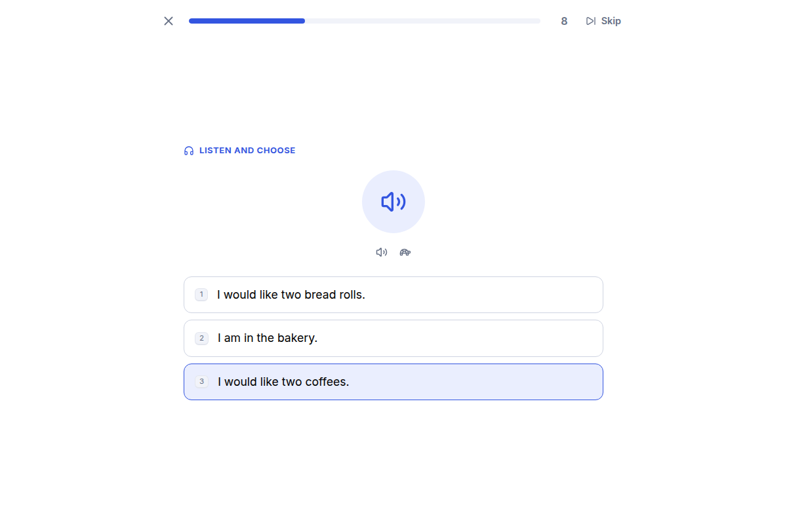 |

| Put the sentence in order | Optional spelling practice |
| :--: | :--: |
| 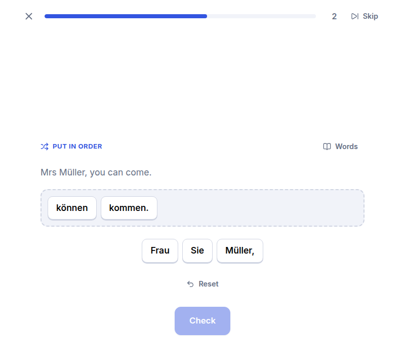 | 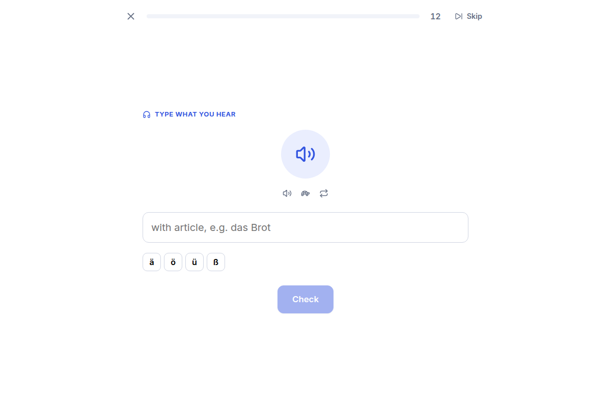 |

| Importing lesson files | Settings |
| :--: | :--: |
| 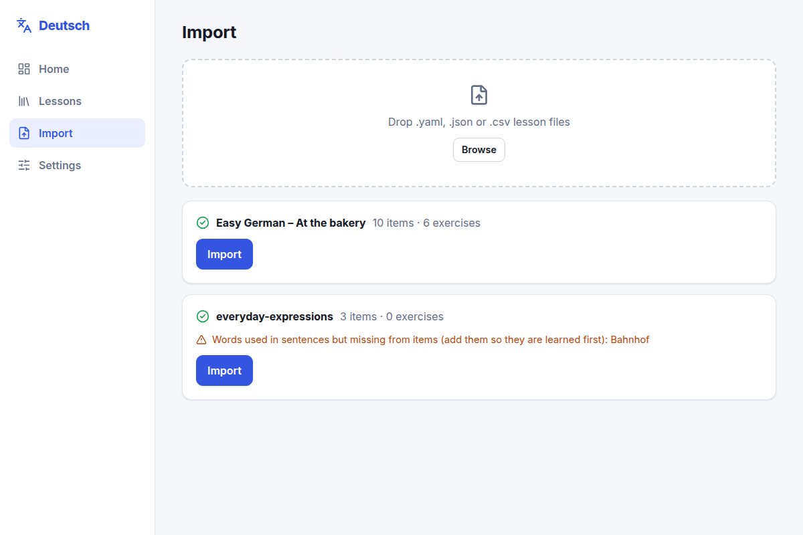 | 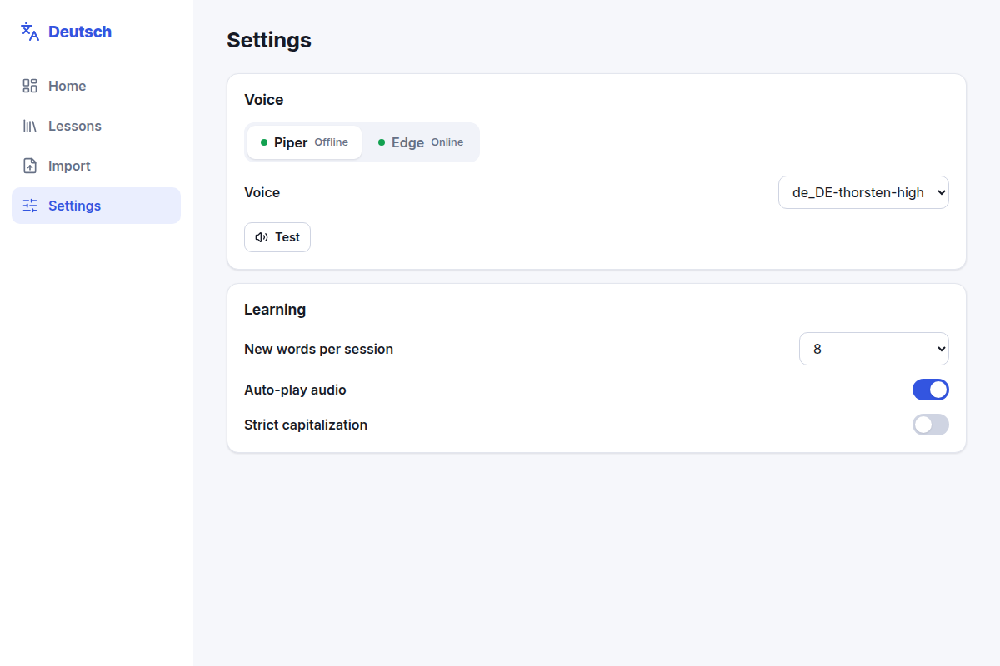 |

Works on a phone-sized screen too:

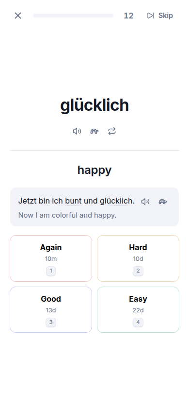

## Quick start

### Requirements

- **Node.js** 20.19+ or 22.12+ (developed on Node 24)
- **Python 3.12** for the local voice service (any Python that can install `piper-tts` works; I used 3.12 via [uv](https://docs.astral.sh/uv/))

### 1. Install the app

```bash
git clone <your-repo-url> deutsch-trainer
cd deutsch-trainer
npm install
```

### 2. Set up the voice service (once)

The app speaks German through a tiny local server (`tts-service/`) that runs the Piper voice model offline and, optionally, Microsoft Edge voices.

```bash
# from the project root
uv venv --python 3.12 .venv
uv pip install --python .venv/bin/python -r tts-service/requirements.txt

mkdir -p tts-service/voices
.venv/bin/python -m piper.download_voices de_DE-thorsten-high --data-dir tts-service/voices
```

No `uv`? Use `python3.12 -m venv .venv && .venv/bin/pip install -r tts-service/requirements.txt` instead.

### 3. Run it

Two terminals:

```bash
npm run tts    # voice service on http://127.0.0.1:8787
npm run dev    # app on http://localhost:5173
```

Open <http://localhost:5173>. If the voice service is not running, the app keeps working and shows an "Audio offline" notice.

> Your progress is stored per browser **and per address**. `localhost:5173` and `localhost:5174` do not share data, so keep using the same one.

## How to use it

### 1. Prepare a lesson file

A lesson is one YAML (or CSV) file with your words and, optionally, example sentences and exercises:

```yaml
id: yt-bakery-01
title: "Easy German – At the bakery"
tags: [video, a1, food]

items:
  - kind: noun
    de: Brot
    article: das
    plural: Brote
    en: bread
    example: { de: "Ich hätte gern ein Brot.", en: "I would like a loaf of bread." }
  - { kind: verb, de: bestellen, en: to order, forms: { er: bestellt } }

exercises:
  - type: listen_choose
    audio: "Ich hätte gern ein Brot."
    options: ["I would like a loaf of bread.", "I am hungry."]
    correct: 0
  - type: word_order
    prompt_en: "I would like a loaf of bread."
    tokens: [Ich, hätte, gern, ein, Brot]
    answers: ["Ich hätte gern ein Brot"]
```

The complete reference (all fields, exercise types, CSV format, tips and a ready-to-use prompt for generating lessons with a tool of your choice) is in **[LESSON_FORMAT.md](LESSON_FORMAT.md)**. Working samples are in [`sample-lessons/`](sample-lessons/).

One rule makes the learning order work: **every content word used in a sentence or exercise should also be a word item.** The importer warns you when one is missing.

### 2. Import it

Open **Import**, drop one or more `.yaml` / `.json` / `.csv` files, check the preview (counts and warnings) and press **Import**. If the voice service is running, audio for every word, example and exercise answer is generated right away, so practice never waits. Importing a file with an existing lesson `id` updates that lesson and keeps your progress on unchanged items.

### 3. Learn the words

Open a lesson and press **Words**. Each new word is shown with its article, plural, meaning and example, and spoken aloud. It then comes back as:

- **Reading** – you see the German word, think of the meaning, press *Show answer*.
- **Listening** – you only hear the word, think of the meaning, press *Show answer*.

Rate yourself **Again / Hard / Good / Easy**; the button shows when the card will return. A word counts as *learned* once it has passed its short learning steps.

Not in the mood for a card? **Skip** (top right of any study screen) sets it aside for this session only. Nothing is recorded, so it simply comes back next time.

### 4. Drill what you want

Each lesson has a **Practice** row:

| Button | What it does |
| --- | --- |
| **Reading** | Only German → meaning cards |
| **Listening** | Only hear → meaning cards |
| **Spelling** *(optional)* | Type the German word (from the English meaning, or from what you hear). Only offers words you have already learned and never appears in Review |

Drills show what is due and, if little is due, top up with the next cards so you can practise ahead.

### 5. Move on to sentences

When about **80 %** of a lesson's words are learned, **Sentences** unlocks (or press *Unlock* to skip ahead). It covers:

- listening to the example sentence of each word, then seeing its meaning
- your exercises: **listen and choose**, **multiple choice**, **put in order**, **fill in the blank**, **translate**

Hover or focus any known word in a sentence to see its meaning, or press **Words** in an exercise to see the vocabulary it uses. After each answer you hear the correct sentence and see your explanation.

### 6. Review daily

The **Home** page shows how many cards are due across all enabled lessons. **Review** mixes reading, listening and sentence cards. Spelling is never included.

### Keyboard shortcuts

| Key | Action |
| --- | --- |
| `Enter` | Show answer / check / continue |
| `Space` | Replay the audio |
| `1` – `4` | Rate a card (Again, Hard, Good, Easy), or pick an answer in multiple-choice exercises |
| `Backspace` | Remove the last word in a word-order exercise |

On-screen buttons for **ä ö ü ß** are available wherever you type.

### Settings

- **Voice:** Piper (offline, default) or Edge (more natural, needs internet; uses an unofficial service that could change). If one fails, the other is tried.
- **New words per session**, **auto-play audio**, and **strict capitalization** (off by default, so `brot` is accepted for `Brot`; umlauts may be typed as `ae/oe/ue/ss`).

## Videos: learn from YouTube

The **Videos** tab plays YouTube videos with learning subtitles. Each line is shown under the video; hover a word to see its meaning, show the translation when you need it, and replay, loop or slow down a line.

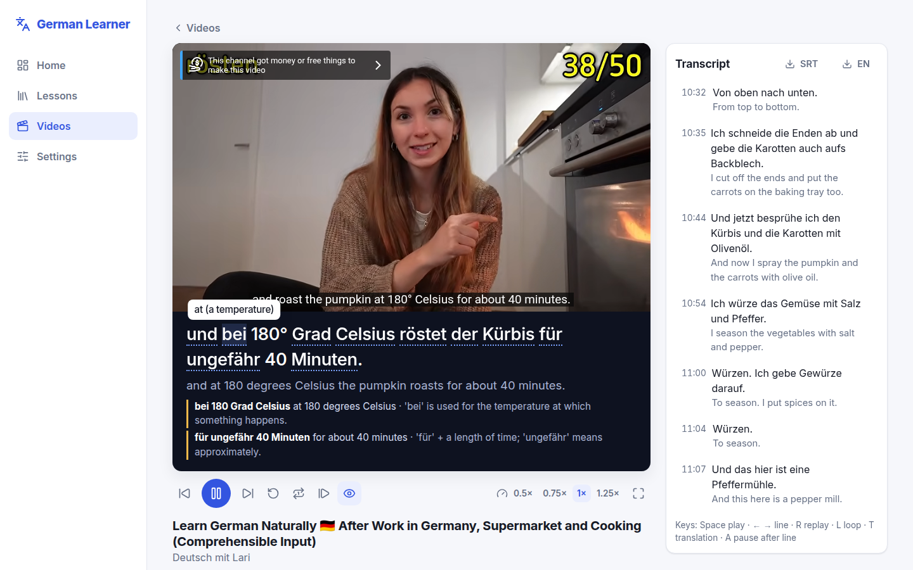

The subtitles are created by the browser extension in [`extension/`](extension/README.md):

1. Open a YouTube video and click the extension (or right-click the page).
2. It reads the video's transcript and asks your AI chat (ChatGPT or Claude, the account you're already logged in to) for translations and word meanings, a part at a time.
3. It opens the result in the app. Timing and the original text always come from YouTube; the AI only adds translations and meanings.

On the video page, **Create lesson** turns the video's words and phrases into a words-only lesson (each word once, spoken lines are not used as example sentences), so you can learn the words first and then watch. **Lesson file** downloads it in the lesson format.

The extension needs no API key. Setup and troubleshooting are in [extension/README.md](extension/README.md). The file format, for making or editing subtitles yourself, is in [VIDEO_FORMAT.md](VIDEO_FORMAT.md). You can also import a plain `.srt` or `.vtt` with a YouTube link.

| Key | In the player |
| --- | --- |
| `Space` | Play / pause |
| `←` `→` | Previous / next line |
| `R` | Replay the line |
| `L` | Loop the line |
| `A` | Pause after each line |
| `T` | Show / hide the translation |

Videos are embedded with YouTube's official player. The subtitles sit below it, never over it, and fullscreen keeps them visible.

## Configuration

The only setting outside the app is the voice service address. Copy `.env.example` to `.env` to change it:

```bash
VITE_TTS_URL=http://localhost:8787
```

## Project structure

```
src/
  core/        schema, importer (YAML/CSV), grading, spaced repetition, session builder, vocabulary lookup
  db/          IndexedDB (Dexie) tables and progress queries
  audio/       text-to-speech engines, player, settings
  exercises/   one component per exercise type + registry
  core/video/  video subtitle format, transcript parsing, AI prompt and reply parsing (shared with the extension)
  ui/          pages, study screens, styles
extension/     browser extension that creates video subtitles (see extension/README.md)
e2e/           browser tests for the video player and the extension
tts-service/   local FastAPI voice server (Piper, Edge) with an on-disk audio cache
sample-lessons/  example lessons
docs/screenshots/
tests/         Vitest tests
```

Adding an exercise type means: a schema in `src/core/schema`, a component registered in `src/exercises`, and a short section in `LESSON_FORMAT.md`.

## Development

```bash
npm run dev        # app with hot reload
npm run tts        # voice service
npm test           # unit tests (schema, importer, grading, scheduling, sessions)
npm run typecheck
npm run build

npm run ext:build          # build the extension into extension/dist
npm run ext:watch          # rebuild the extension on change
npm run ext:typecheck
npm run e2e:video          # browser test of the video player (app running on :5174)
npm run e2e:extension      # browser test of the whole extension flow against mock pages (app on :5174)
```

Built with TypeScript, React, Vite, Dexie, Zod, ts-fsrs and lucide icons; the voice service uses FastAPI, Piper and edge-tts.

## Your data

Lessons, videos and progress live in your browser's IndexedDB. Generated audio is cached in `tts-service/cache/` (safe to delete; it is regenerated on demand). **There is no backup or export yet, so clearing site data erases your progress.**

## Roadmap

- Export / import of all progress as a file
- Installable offline app (PWA)
- Statistics and a list of difficult words
