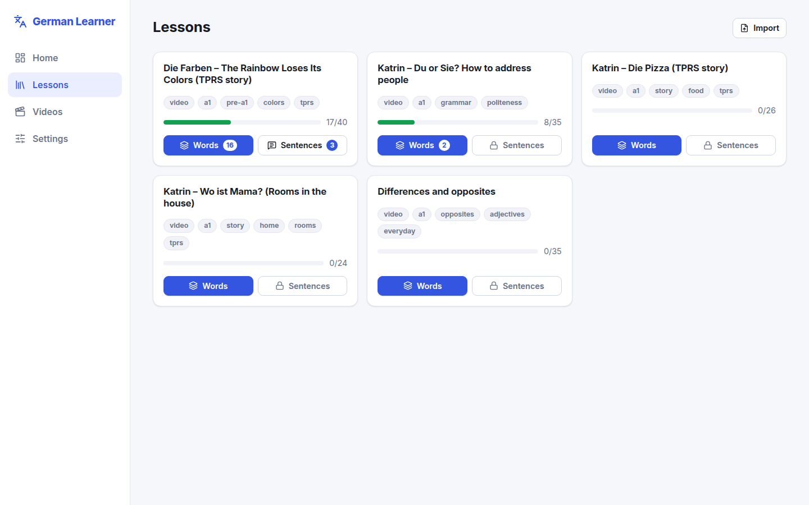
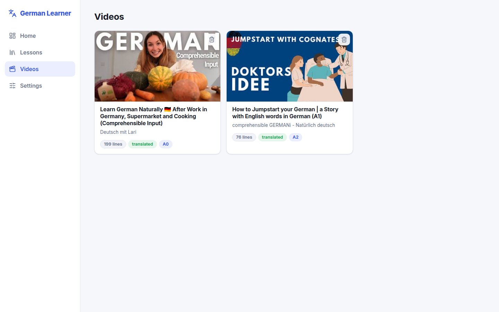
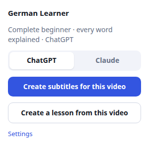
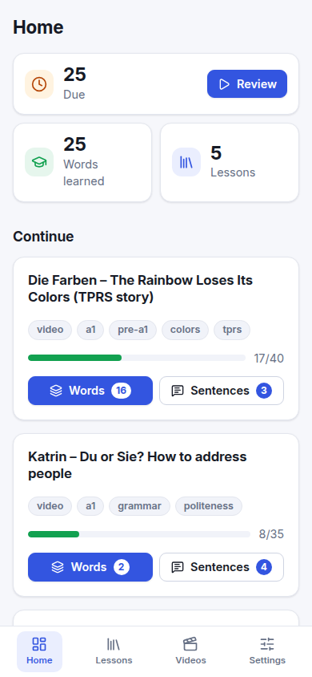
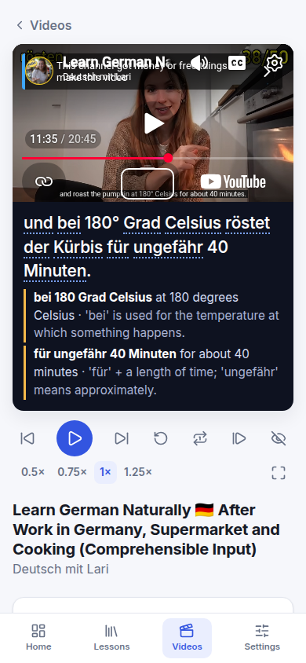

# German Learner

A personal, local-first app for learning German. You learn the **words first**, by **reading** them and by **hearing** them, with spaced repetition and natural-sounding speech that runs on your own computer. Then you watch real **YouTube videos with learning subtitles**: every line with its translation and the meaning of every word.

Lessons and subtitles come from a small browser extension that uses the AI chat you are already logged in to (ChatGPT or Claude). No accounts, no API keys, no cloud service: your lessons, videos and progress stay in your browser.


## Why it exists

Learning from comprehensible input (videos, stories, podcasts) stalls when you don't know enough words to follow along. This app closes that gap:

- **Learn from what you actually watch.** Turn a YouTube video into a lesson with its useful words and phrases, learn them, then watch the video with subtitles that explain every word.
- **Words before sentences.** You are assumed to know almost no German, so every content word is learned first. Sentences and exercises unlock only after most of a lesson's words are learned.
- **Recognition first.** The main path is *reading* a word and recalling its meaning, and *hearing* a word and recalling its meaning. Typing (spelling) is a separate, optional practice.
- **Listening is central.** Every word and sentence can be played at normal or slow speed, on repeat.
- **Repetition that adapts.** Cards come back on a spaced-repetition schedule ([FSRS](https://github.com/open-spaced-repetition/ts-fsrs)), so what you struggle with returns sooner.

## A tour

| Lessons | A lesson |
| :--: | :--: |
|  |  |

**Learning words.** Each new word is shown with its article (colour-coded *der* / *die* / *das*), meaning, plural and an example sentence, and spoken aloud. It then returns as reading and listening cards that you rate yourself.

| Meeting a new word | Reading: recall the meaning |
| :--: | :--: |
|  |  |

| Listening: hear it, recall the meaning | Optional spelling practice |
| :--: | :--: |
|  |  |

**Sentences and exercises** unlock when most of a lesson's words are learned.

| Listen and choose | Put the sentence in order |
| :--: | :--: |
|  |  |

**Videos.** Every subtitle line sits under the video with its translation. Hover a word for its meaning in that sentence and its dictionary form; fixed phrases are explained as a whole, with why they mean what they mean.


| Your videos | The browser extension |
| :--: | :--: |
|  |  |

It works on a phone-sized screen too:

| | | |
| :--: | :--: | :--: |
|  |  |  |

## Getting started: from the repo to your first video

This walks you through everything once, in order: install the app, start it, add the browser extension by hand (it is not published in any extension store), and turn your first German YouTube video into subtitles and a lesson. It takes about 15 minutes, most of it downloads.

### What you need

- **Node.js** 20.19+ or 22.12+ (developed on Node 24): <https://nodejs.org>
- **Python 3.12** for the local voice service. Any Python that can install `piper-tts` works; [uv](https://docs.astral.sh/uv/) makes this easy.
- **Chrome, Edge or Brave** (the extension is built for Chromium browsers).
- A **ChatGPT** or **Claude** account, logged in in that same browser. No API key is needed. On a free plan, long videos may run into the chat's message limits; shorter videos are a good first try.
- Git.

The commands below are for **Linux and macOS**. Windows differences are noted where they matter.

### Step 1: Get the code and install it

```bash
git clone https://github.com/zohaib-119/german-learner.git
cd german-learner
npm install
```

### Step 2: Set up the voice service (once)

The app speaks German through a small local server in `tts-service/`. It runs the **Piper** voice model offline on your computer and can also use Microsoft **Edge** voices online.

```bash
# from the project root
uv venv --python 3.12 .venv
uv pip install --python .venv/bin/python -r tts-service/requirements.txt

mkdir -p tts-service/voices
.venv/bin/python -m piper.download_voices de_DE-thorsten-high --data-dir tts-service/voices
```

- No `uv`? Use `python3.12 -m venv .venv && .venv/bin/pip install -r tts-service/requirements.txt`.
- **Windows:** use `.venv\Scripts\python` instead of `.venv/bin/python`.

The voice file is about 110 MB and is downloaded only once.

### Step 3: Start the app

Open **two terminals** in the project folder and leave both running:

```bash
# terminal 1: the voice service, on http://127.0.0.1:8787
npm run tts
```

```bash
# terminal 2: the app, on http://localhost:5173
npm run dev
```

**Windows:** `npm run tts` uses a Linux/macOS path. Start the voice service with `cd tts-service` and then `..\.venv\Scripts\uvicorn app:app --port 8787 --host 127.0.0.1`.

Open <http://localhost:5173> in your browser. You should see the **Home** page. If the voice service isn't running, the app still works and shows an "Audio offline" notice. Check **Settings → Voice → Test** to hear it.

> Your lessons and progress are stored in the browser **for this exact address**. Always open the app at `http://localhost:5173`: a different port or browser starts empty.

### Step 4: Build the browser extension and add it to your browser

The extension isn't published in the Chrome Web Store, so you build it and load it yourself (once):

```bash
npm run ext:build      # creates extension/dist
```

1. Open the extensions page: `chrome://extensions` (Edge: `edge://extensions`, Brave: `brave://extensions`).
2. Turn on **Developer mode** (top right; in Edge it's on the left).
3. Click **Load unpacked** and choose the **`extension/dist`** folder inside the project. Choose `dist`, not `extension` itself.
4. **German Learner – Video Subtitles and Lessons** appears in the list. Click the puzzle-piece icon in the toolbar and **pin** it so its button is always visible.

The extension expects the app at `http://localhost:5173`. If you run it elsewhere, open the extension's **Settings** and change **App address**.

> After you update the code (for example `git pull`), run `npm run ext:build` again and press the **reload** arrow on the extension's card in the extensions page.

### Step 5: Log in to your AI chat

In the same browser, open <https://chatgpt.com> or <https://claude.ai> and log in. The extension writes into that chat for you, using your account. ChatGPT uses a temporary chat, so nothing is added to your history.

### Step 6: Your first video: learning subtitles

1. Make sure the app (`npm run dev`) and the voice service (`npm run tts`) are still running.
2. Open a **German** video on YouTube that has subtitles. Auto-generated ones are fine: if you see **…more → Show transcript** under the video, it works. Videos made for learners (Easy German, Deutsch mit Lari, comprehensible-input channels) are a good start.
3. Click the extension's button in the toolbar. Choose **ChatGPT** or **Claude** (remembered for next time).
4. Press **Create subtitles for this video**.


What happens next, by itself:

- A **job page** opens and shows four steps: *Read the transcript → Translate with ChatGPT → Build the subtitle file → Open in German Learner*.
- It reads the transcript from the YouTube tab, then opens a **chat tab** and sends the transcript in parts. You'll see it type and send messages there. **Leave the tabs alone** until it's done: a 10-minute video takes a few minutes.
- When it's finished, the app opens on the **Videos** page with your video in the player. Press play, hover any word for its meaning, and press `T` for the translation.

The video is saved: it's in **Videos** from now on, and clicking the extension on the same video again offers **Open in app** (instant, no AI) or **Create again**.

If something goes wrong, the job page says what happened, and **Details** at the bottom shows a log. If the transcript can't be read automatically, the job page asks you to paste it: open **…more → Show transcript** on YouTube, select all, copy, paste. More help is in [extension/README.md](extension/README.md#when-something-goes-wrong).

### Step 7: The same video as a lesson

To learn the video's words before (or after) watching it:

1. On the same YouTube video, click the extension again and press **Create a lesson from this video**.
2. The job page runs again: your AI chat writes a lesson from the transcript, following [docs/LESSON_FORMAT.md](docs/LESSON_FORMAT.md). The extension checks it and, if needed, asks the AI to fix it.
3. The app opens the lesson under **Lessons**. Press **Start** to meet the first words.

From here, see **How to use it** below.

### Every day after that

```bash
npm run tts     # terminal 1
npm run dev     # terminal 2
```

Then open <http://localhost:5173>, press **Review** on Home for what's due, and use the extension on any new video you want to learn from.

## How to use it

### 1. Get lessons

A lesson is a list of German words and phrases, with example sentences and exercises. There are two ways to get one:

- **From a YouTube video (extension).** Open the video, click the extension and choose **Create a lesson from this video**. Your AI chat receives the transcript together with the [lesson format guide](docs/LESSON_FORMAT.md) and writes the lesson: the useful words and phrases, proper written example sentences (spoken lines are often not good examples) and exercises at your level. The extension checks the result with the app's own importer, asks the AI to fix any problems, and opens the lesson in the app. Doing it again for the same video updates that lesson.
- **From a lesson file.** On **Lessons**, press **Import** and drop `.yaml`, `.json` or `.csv` files you wrote yourself or with any AI tool. The preview shows counts and warnings before you import.


The lesson file format (all fields, exercise types, CSV, and a ready-to-paste prompt) is described in **[docs/LESSON_FORMAT.md](docs/LESSON_FORMAT.md)**. Working samples are in [`sample-lessons/`](sample-lessons/). One rule makes the learning order work: **every content word used in a sentence or exercise should also be a word in the lesson.** The importer warns you when one is missing.

If the voice service is running, audio for every word, example and exercise is generated as soon as a lesson arrives, so practice never waits.

### 2. Learn the words

Open a lesson and press **Start** (or **Words** on its card). Each new word is introduced, then comes back as:

- **Reading**: you see the German word, think of the meaning, press *Show answer*.
- **Listening**: you only hear the word, think of the meaning, press *Show answer*.

Rate yourself **Again / Hard / Good / Easy**; each button shows when the card will return. A word counts as *learned* once it has passed its short learning steps. **Skip** (top right of any study screen) sets a card aside for this session only.

### 3. Drill what you want

Each lesson has a **Practice** row:

| Button | What it does |
| --- | --- |
| **Reading** | Only German → meaning cards |
| **Listening** | Only hear → meaning cards |
| **Spelling** *(optional)* | Type the German word (from the English meaning, or from what you hear). Only offers words you have already learned and never appears in Review |

### 4. Move on to sentences

When about **80 %** of a lesson's words are learned, **Sentences** unlocks (or press *Unlock* to go ahead). It covers listening to each word's example sentence, and the lesson's exercises: **listen and choose**, **multiple choice**, **put in order**, **fill in the blank** and **translate**. Hover any word you know in a sentence for its meaning. After each answer you hear the correct sentence and see the explanation.

### 5. Review daily

**Home** shows how many cards are due across all lessons that are *in review* (the switch on each lesson). **Review** mixes reading, listening and sentence cards. Spelling is never included.

### 6. Watch videos with learning subtitles

On a YouTube video, click the extension and choose **Create subtitles for this video**. It reads the video's own transcript, asks your AI chat for a translation of every line and the meaning of every word (with its dictionary form) and phrase, and opens the result under **Videos**. Timing and the German text always come from YouTube; the AI only adds translations and meanings. Finished videos are saved, so they are never made twice.

In the player you can show or hide the translation, replay or loop a line, pause after every line, slow down to 0.5×, and go fullscreen with the subtitles still visible. Words you have learned in your lessons are underlined in green.

Subtitles and lessons are separate: make either or both for a video. The subtitle file format is described in [docs/VIDEO_FORMAT.md](docs/VIDEO_FORMAT.md).

### Keyboard shortcuts

| Key | While studying |
| --- | --- |
| `Enter` | Show answer / check / continue |
| `Space` | Replay the audio |
| `1` – `4` | Rate a card (Again, Hard, Good, Easy), or pick an answer |
| `Backspace` | Remove the last word in a word-order exercise |

| Key | In the video player |
| --- | --- |
| `Space` | Play / pause |
| `←` `→` | Previous / next line |
| `R` | Replay the line |
| `L` | Loop the line |
| `A` | Pause after each line |
| `T` | Show / hide the translation |

On-screen buttons for **ä ö ü ß** are available wherever you type.

### Settings


- **Voice:** Piper (offline, default) or Edge (more natural, needs internet; uses an unofficial service that could change). If one fails, the other is tried.
- **New words per session**, **auto-play audio**, and **strict capitalization** (off by default, so `brot` is accepted for `Brot`; umlauts may be typed as `ae/oe/ue/ss`).

The extension has its own settings (your level, how many words to explain, ChatGPT or Claude, the app address): see [extension/README.md](extension/README.md).

## Configuration

The only setting outside the app is the voice service address. Copy `.env.example` to `.env` to change it:

```bash
VITE_TTS_URL=http://localhost:8787
```

## Project structure

```
src/
  core/          lesson schema, importer (YAML/JSON/CSV), grading, spaced repetition, sessions, vocabulary lookup
  core/video/    subtitle format, transcript parsing, AI prompt and reply parsing (shared with the extension)
  core/lesson-ai.ts   prompt and answer checking for lessons written from a transcript (used by the extension)
  db/            IndexedDB (Dexie) tables and progress queries
  audio/         text-to-speech engines, player, settings
  exercises/     one component per exercise type
  ui/            pages, study screens, video player, styles
extension/       browser extension: subtitles and lessons from YouTube videos (see extension/README.md)
tts-service/     local voice server (FastAPI, Piper, Edge) with an on-disk audio cache
docs/            LESSON_FORMAT.md, VIDEO_FORMAT.md, screenshots
sample-lessons/  example lesson files
tests/           unit tests (Vitest)
e2e/             browser tests for the video player and the extension
```

Adding an exercise type means: a schema in `src/core/schema`, a component in `src/exercises`, and a short section in `docs/LESSON_FORMAT.md` (which the extension also sends to the AI).

## Development

```bash
npm run dev        # app with hot reload
npm run tts        # voice service
npm test           # unit tests
npm run typecheck
npm run build

npm run ext:build          # build the extension into extension/dist
npm run ext:watch          # rebuild the extension on change
npm run ext:typecheck
npm run e2e:video          # browser test of the video player (app running on :5174)
npm run e2e:extension      # browser test of the extension against local mock pages (app on :5174)
```

Built with TypeScript, React, Vite, Dexie, Zod, ts-fsrs and lucide icons; the voice service uses FastAPI, Piper and edge-tts; the extension is bundled with esbuild.

## Your data

Lessons, videos and progress live in your browser's IndexedDB. Generated audio is cached in `tts-service/cache/` (safe to delete; it is regenerated on demand). **There is no backup or export yet, so clearing the site's data erases your progress.**

Videos are played with YouTube's official embedded player; the subtitles sit below it, never over it. Transcripts are read for your personal use only: don't publish other people's transcripts.

## Roadmap

- Export / import of all progress as a file
- Installable offline app (PWA)
- Statistics and a list of difficult words
