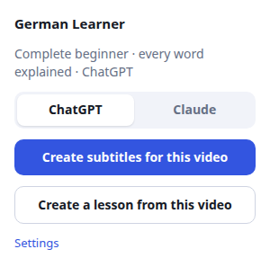
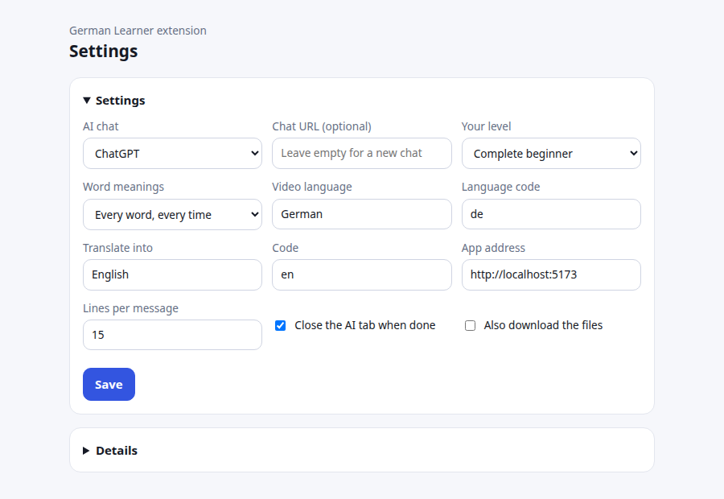

# German Learner – browser extension

Turns any German YouTube video into **learning subtitles** or a **lesson** for the German Learner app in a few clicks, using the AI chat you are already logged in to (ChatGPT or Claude). No API keys. The two are separate jobs; make either or both.



**Create subtitles for this video:**

1. **Transcript.** It opens YouTube's own *Show transcript* panel in your tab and reads the timed lines.
2. **AI.** It opens a new chat (ChatGPT or Claude), pastes the lines in parts with instructions, and waits for each answer. The answer contains a translation of every line, the meaning of every word (with its dictionary form, repeats included) and the fixed phrases explained as a whole. With *Only harder words* in Settings it explains just the words a learner at your level may not know. If a line is missing from an answer, it asks again for just that line.
3. **Build.** It combines the answers with the original lines. **Timing and German text always come from YouTube, never from the AI**, so the subtitles stay in sync. The result is checked against the same format the app uses.
4. **App.** It opens the app's **Videos** page and hands the subtitles over. The video starts in the player with hover-for-meaning subtitles.

You can watch the progress on the extension's job page, which also lets you download the result as `.json` or `.srt`.

**Create a lesson from this video:**

1. **Transcript**, as above.
2. **AI.** One message with the whole transcript and the app's lesson format guide ([docs/LESSON_FORMAT.md](../docs/LESSON_FORMAT.md), built into the extension). The AI picks the useful words and phrases, writes proper written example sentences (spoken lines are often not good examples) and exercises, at your level.
3. **Check.** The answer is validated with the app's own lesson importer. If it has errors, or uses words in sentences that are not items, the AI is asked once to fix them.
4. **App.** The lesson opens under **Lessons**, like an imported lesson file. Its id is `yt-<video id>`, so making it again updates the same lesson and keeps your progress on unchanged words. The job page also offers the lesson as a `.json` file.

## Install

```bash
npm install            # once, from the project root
npm run ext:build      # builds into extension/dist
```

1. Open `chrome://extensions` (also works in Edge and Brave).
2. Turn on **Developer mode**.
3. Click **Load unpacked** and choose the `extension/dist` folder.

After changing the code, run `npm run ext:build` again (or keep `npm run ext:watch` running) and press the reload button on the extension card.

## Use

1. Start the app (`npm run dev`) and make sure you are logged in to ChatGPT or Claude in the same browser.
2. Open a YouTube video.
3. Click the extension icon, pick **ChatGPT** or **Claude** (your choice is remembered), and press **Create subtitles for this video** or **Create a lesson from this video**. Both are also in the right-click menu on the page.
4. Leave the tabs alone until the job page says it is done. A 10-minute video takes a few AI messages, which usually takes a few minutes.

### Videos you already did

Every finished video is saved in the extension's own library (in your browser), and also in the app's **Videos** tab, where you can play it any time. When you click the extension on a video that's already done, the popup shows **Subtitles ready** with:

- **Open in app**: sends the saved subtitles to the app straight away, with no AI and no waiting. This also restores a video you deleted in the app.
- **Create again**: makes new subtitles, for example with the other AI or after changing your level.

### Settings

Open them from the popup (**Settings**) or at the bottom of the job page.



| Setting | Default | Notes |
| --- | --- | --- |
| AI chat | ChatGPT | ChatGPT uses a temporary chat, so nothing is added to your history. |
| Chat URL | empty | Use a specific chat or project URL instead of a new chat. |
| Your level | Complete beginner | Shapes the translations and meanings. |
| Word meanings | Every word, every time | Every word of every line is explained, repeats included, with its dictionary form. "Only harder words" gives shorter answers. Phrases are always explained. |
| Video language / code | German / `de` | The code picks the caption track if the panel can't be read. |
| Translate into / code | English / `en` | |
| App address | `http://localhost:5173` | Change it if your app runs on another port. |
| Lines per message | 15 | Explaining every word makes answers long; lower it if the AI cuts its answers short. |
| Close the AI tab when done | on | |
| Also download the files | off | Downloads `.json` and `.srt` automatically. |

## When something goes wrong

| What you see | What to do |
| --- | --- |
| "Could not read the transcript… Paste it below" | On YouTube open **…more → Show transcript**, select all the lines, copy and paste them into the box on the job page. `.srt`/`.vtt` text works too. Videos without any captions can't be used. |
| "did not start answering. Are you logged in?" | Log in to the AI site in this browser and start again. |
| "did not accept the text in its chat box" or the job hangs on the AI step | The AI site probably changed its page. The selectors are at the top of `src/ai-content.ts`. |
| "Is the app running at …?" | Start the app, check the address in Settings, then press **Send to app again**. For a lesson you can also download the `.json` and import it on the app's Lessons page. |
| "The lesson from … is not valid" | The AI's lesson still had errors after one fix. Run it again, or try the other AI. |
| Some lines have no translation | The AI skipped them twice. They still play with the German text; you can re-run the video later. |

**Details** at the bottom of the job page shows a log of every step, which helps when reporting a problem.

## Privacy and rules

- The transcript is sent to the AI chat you choose, under your account. Nothing else leaves your browser, and the extension has no server.
- Reading a transcript with an extension is not an official YouTube feature, and AI sites don't offer automation either. This is meant for **personal use**. Pages can change at any time, which can break a step until the selectors are updated.
- The finished subtitles are stored only in your app. Don't publish other people's transcripts.

## How it is built

```
extension/
  manifest.json        Manifest V3: permissions, content scripts
  build.mjs            esbuild bundler -> dist/
  src/
    popup.*            toolbar popup: starts a subtitle or lesson job for the current YouTube tab
    background.ts      right-click menu entry on YouTube pages
    job.*              the job page: runs the pipeline and shows progress (no service-worker time limits)
    youtube-scrape.ts  injected into the YouTube tab; reads the transcript panel, falls back to the caption track
    ai-content.ts      content script on ChatGPT / Claude: writes the prompt, sends it, waits for the reply
    app-content.ts     content script on localhost: passes the result to the app with window.postMessage
    library.ts         saved finished subtitles per video (chrome.storage, unlimitedStorage)
    settings.ts        stored settings
```

The prompts, the reply parsers, line merging and the file formats live in the app's `src/core/video/` and `src/core/lesson-ai.ts`, which the extension imports (along with the app's lesson importer). The two can't drift apart, and that logic is unit-tested with the app (`npm test`).

The app accepts results only from same-window messages with the expected envelope, and validates them with the same schema as a manual import (`src/ui/videos/bridge.ts`).

### Development

```bash
npm run ext:watch        # rebuild on change
npm run ext:typecheck
npm run e2e:extension    # loads the built extension in Chromium against mock YouTube/chat pages (app must run on :5174)
```

The end-to-end test uses local mock pages that copy the structure the extension relies on (`e2e/mock-sites.mjs`). It proves the extension's own logic, not that today's YouTube, ChatGPT or Claude pages still match.
